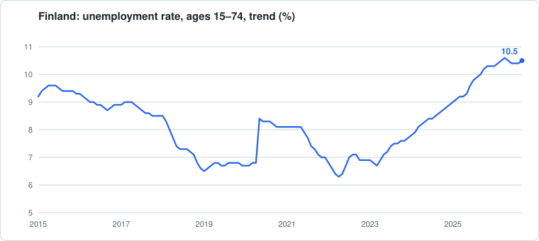
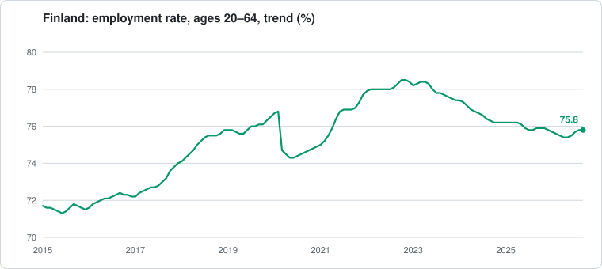
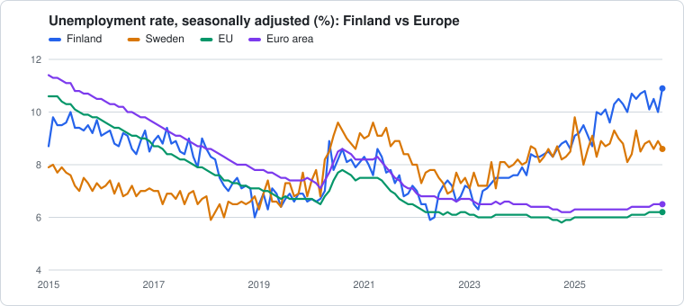
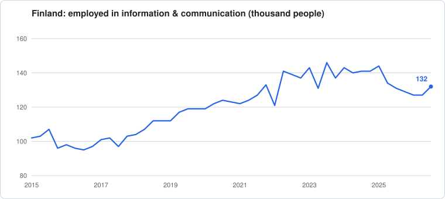
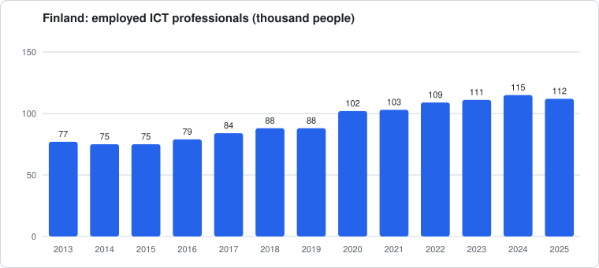

# 🇫🇮 Finland Employment Data

[⬅ Back to the list of tech companies](README.md)

> 📅 **Last updated:** 2026-11-09 · Statistics Finland data up to **September 2026** · Eurostat data up to **September 2026**

A quick look at how the Finnish labour market is doing, how it compares with the rest of Europe, and what the numbers say about the information and communication (ICT) sector. All figures come from official open data and this page is generated by [`scripts/update_employment_data.py`](scripts/update_employment_data.py).

---

## 📊 Latest figures: September 2026

#### Number of unemployed people

## ~298,000

*September 2026 · estimate from a sample survey*

#### Europe Ranking

## 1 of 27

*The highest unemployment rate in the EU · 10.9% in September 2026*

**Key figures**

- In September 2026, the number of employed persons was **2,578,000** and that of unemployed persons **298,000**.
- There were **59,000** fewer employed men and **48,000** more employed women than in September 2025.
- There were **17,000** more unemployed men and **22,000** more unemployed women than in September 2025.
- The trend of the employment rate among persons aged 20 to 64 was **75.8 per cent** in September.
- The trend of the unemployment rate among persons aged 15 to 74 was **10.5 per cent** in September.

| Indicator | Latest (not adjusted) | Trend | Year ago | Change vs. year ago |
| --- | ---: | ---: | ---: | ---: |
| Employed (thousand people) | 2,578 | 2,590 | 2,589 | -11 |
| Unemployed (thousand people) | 298 | 308 | 259 | +39 |
| Employment rate, ages 20–64 (%) | 75.1 | 75.8 | 75.9 | -0.8 pp |
| Unemployment rate (%) | 10.4 | 10.5 | 9.1 | +1.3 pp |
| Youth unemployment rate, ages 15–24 (%) | 22.0 | 23.5 | 16.6 | +5.4 pp |

*Trend* is adjusted for seasonal and random variation, so it is the best series for judging the direction of the labour market. The latest trend values are preliminary and may be revised. Ages 15–74 unless stated. The monthly figures come from a sample survey and carry a margin of error of tens of thousands of people for the totals, so small changes between months are not meaningful.

---

## 🇪🇺 How Finland compares with Europe: September 2026

Seasonally adjusted unemployment rate, ages 15–74. **Finland:** Official Statistics of Finland (Statistics Finland). **All other countries and regions:** Eurostat (harmonised ILO definition).

> 🏆 **Finland's ranking in Europe: 1 of 27.** With 10.9% in September 2026, Finland has the highest unemployment rate of the 27 EU countries with data (EU average 6.2%).  
> **Youth unemployment (under 25): 1 of 26**, 25.2% in September 2026, so the highest among the EU countries with data for that month (EU average 15.5%).

| Region | September 2026 | September 2025 | Change (pp) |
| --- | ---: | ---: | ---: |
| **Finland** | **10.9** | 9.6 | +1.3 |
| Sweden | 8.6 | 8.8 | -0.2 |
| Estonia | 8.0 | 7.1 | +0.9 |
| Denmark | 6.8 | 6.3 | +0.5 |
| Euro area | 6.5 | 6.3 | +0.2 |
| EU (27 countries) | 6.2 | 6.0 | +0.2 |
| Norway | 5.0 | 4.7 | +0.3 |
| Germany | 4.1 | 3.8 | +0.3 |

Show the full EU ranking for September 2026 (1 = highest unemployment)

| Rank | Country | Unemployment rate (%) |
| ---: | --- | ---: |
| 1 | **Finland** | **10.9** |
| 2 | Spain | 10.3 |
| 3 | Sweden | 8.6 |
| 4 | France | 8.5 |
| 5 | Estonia | 8.0 |
| 6 | Greece | 7.6 |
| 7 | Latvia | 7.3 |
| 8 | Luxembourg | 7.3 |
| 9 | Denmark | 6.8 |
| 10 | Romania | 6.3 |
| 11 | Italy | 6.3 |
| 12 | Austria | 6.3 |
| 13 | Lithuania | 6.2 |
| 14 | Belgium | 6.0 |
| 15 | Slovakia | 5.7 |
| 16 | Portugal | 5.6 |
| 17 | Ireland | 4.7 |
| 18 | Hungary | 4.6 |
| 19 | Croatia | 4.3 |
| 20 | Germany | 4.1 |
| 21 | Netherlands | 4.0 |
| 22 | Cyprus | 4.0 |
| 23 | Slovenia | 3.6 |
| 24 | Poland | 3.4 |
| 25 | Malta | 3.4 |
| 26 | Bulgaria | 3.4 |
| 27 | Czechia | 2.8 |

**Youth unemployment (under 25), September 2026:** Finland 25.2% vs. EU 15.5% (a year earlier: 19.9% vs. 15.4%).

> **Why is Finland's rate here different from the table above?** The first table shows the unadjusted figure and the trend. The comparison needs a seasonally adjusted figure (10.9% for September 2026, also from Statistics Finland), because that is what Eurostat publishes for the other countries. Eurostat's own estimate for Finland in September 2026 is 11.0%. Eurostat's figures are revised from release to release. Use the first table to follow Finland's own trend, and the Europe table to compare countries.

---

## 💻 The tech sector in Finland

The Labour Force Survey tables used here do not break unemployment out for ICT workers, but they do show how many people are employed in the information and communication industry and in ICT occupations.

### Employed in the information & communication industry

Industry class J of the national industry classification (publishing, telecommunications, computer programming and consultancy, information services). Quarterly, thousand people.

| Quarter | Information & communication | All industries | Share of all employed |
| --- | ---: | ---: | ---: |
| Q3 2026 | 132 | 2,616 | 5.0% |
| Q2 2026 | 127 | 2,600 | 4.9% |
| Q1 2026 | 127 | 2,536 | 5.0% |
| Q4 2025 | 129 | 2,578 | 5.0% |
| Q3 2025 | 131 | 2,609 | 5.0% |
| Q2 2025 | 134 | 2,629 | 5.1% |
| Q1 2025 | 144 | 2,544 | 5.7% |
| Q4 2024 | 141 | 2,572 | 5.5% |
| Q3 2024 | 141 | 2,623 | 5.4% |

Change from Q3 2025 to Q3 2026: +1 thousand people. Quarters differ seasonally, so compare the same quarter across years.

### Employed in ICT occupations

People working in ICT jobs in any sector (for example developers working in a bank or a factory). Annual, thousand people.

| Year | ICT professionals | ICT technicians | ICT professionals' share of all employed |
| --- | ---: | ---: | ---: |
| 2025 | 112 | 28 | 4.3% |
| 2024 | 115 | 31 | 4.4% |
| 2023 | 111 | 30 | 4.2% |
| 2022 | 109 | 29 | 4.2% |
| 2021 | 103 | 27 | 4.0% |
| 2020 | 102 | 22 | 4.1% |
| 2019 | 88 | 20 | 3.5% |
| 2018 | 88 | 23 | 3.5% |

*ICT professionals* are occupation group 25 and *ICT technicians* group 35 of the Finnish Classification of Occupations 2010. These are survey estimates rounded to thousands, so differences of a few thousand are within the margin of error.

---

## 🔎 Sources and notes

- **Statistics Finland** (all Finnish figures), [Labour Force Survey](https://stat.fi/en/statistics/tyti). Tables: [135z key indicators](https://pxdata.stat.fi/PXWeb/pxweb/en/StatFin/StatFin__tyti/135z.px), [137l employed by industry](https://pxdata.stat.fi/PXWeb/pxweb/en/StatFin/StatFin__tyti/137l.px), [13au employed by occupation](https://pxdata.stat.fi/PXWeb/pxweb/en/StatFin/StatFin__tyti/13au.px).
- **Eurostat** (all other countries, EU and euro area), [monthly unemployment (une_rt_m)](https://ec.europa.eu/eurostat/databrowser/view/une_rt_m/default/table?lang=en) and its [methodology notes](https://ec.europa.eu/eurostat/cache/metadata/en/une_rt_m_esms.htm).
- The numbers come from labour force surveys and are estimates. Totals are rounded and may differ slightly between tables.

### Finnish data citation

> Official Statistics of Finland (OSF): Labour force survey [online publication]. Reference period: 2026, September. ISSN=1798-7857. Helsinki: Statistics Finland [Referenced: 9.11.2026]. Access method: https://stat.fi/en/publication/cmfp99vvraagp08urorj45p22

[Back to top ⬆️](#-finland-employment-data) · [⬅ Back to the list of tech companies](README.md)
